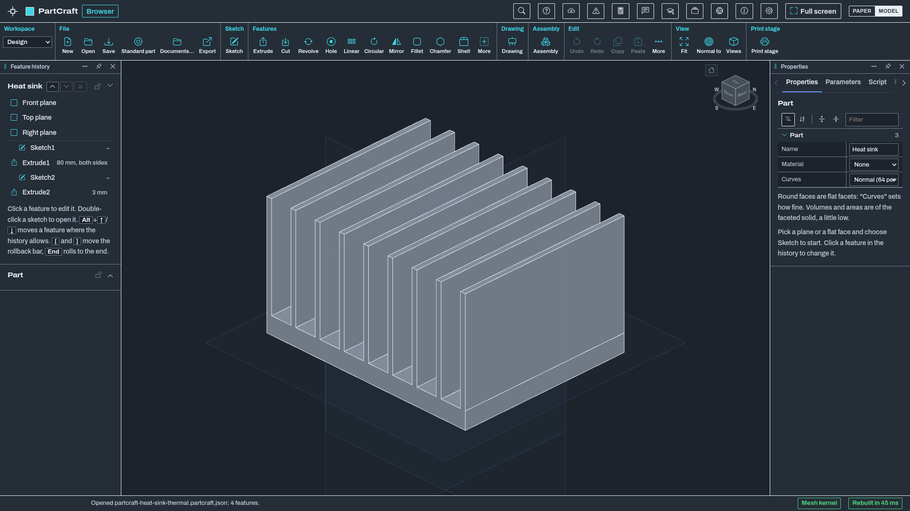

# PartCraft

Sketch, constrain, extrude. Then build the assembly.

**[Website](https://getcadcraft.com/apps/partcraft) | [Use it in your browser](https://getcadcraft.com/use/partcraft) | [Download CadCraft Studio](https://getcadcraft.com/download#studio) | [Help and tutorials](https://getcadcraft.com/tutorials/partcraft) | [News](https://getcadcraft.com/news) | [Suggest a feature](https://getcadcraft.com/suggest)**

[](https://getcadcraft.com/use/partcraft)

<sub>PartCraft 0.9 in the browser, dark theme. [A second view](screenshots/model.png).</sub>

PartCraft is the parametric parts & assemblies app in the [CadCraft](https://getcadcraft.com) family: Constrained sketches, feature history, assemblies with joints and drawings with GD&T. STEP in and out.

## Use it

Use it now at https://getcadcraft.com/use/partcraft, or install CadCraft Studio, which carries all eight apps. Your files stay on your computer either way.

| Platform | Status |
|---|---|
| [Browser](web/) | 0.9: `partcraft-browser-edition-v0.9.0.zip` in [Releases](https://github.com/getcadcraft/partcraft/releases), or build it from a clone ([BUILDING.md](BUILDING.md#the-browser-edition)) |
| Desktop: [Windows](windows/), [Linux](linux/) | In [CadCraft Studio 0.9](https://github.com/getcadcraft/studio/releases/tag/studio-v0.9.0) (installer, `.deb`, AppImage); not code-signed yet |
| [macOS](macos/) | In [CadCraft Studio 0.9](https://github.com/getcadcraft/studio/releases/tag/studio-v0.9.0) (universal disk image; not code-signed or notarized yet) |
| [Android](android/) | The Studio APK, on the [download page](https://getcadcraft.com/download#studio) |
| [iPad](ios/) | From the App Store when Apple releases it (Studio 0.8 is with Apple); not in the store yet |

## Work on it

```sh
node devshell/serve.mjs     # Node 20.19 or newer, no packages; then open http://127.0.0.1:8000/
npm test                    # the app's tests; libraries are fetched by exact version
```

`app/` is the code in development (the same code on every platform; each release is a tag), `web/` `windows/` `linux/` `macos/` `ios/` `android/` hold what ships or builds it on each, `devshell/` runs it without the website (`devshell/README.md`), `tests/` and `fixtures/` are its tests and public sample files. How to contribute: [CONTRIBUTING.md](CONTRIBUTING.md); building from source: [BUILDING.md](BUILDING.md).

## License

Apache License 2.0 ([LICENSE](LICENSE), [NOTICE](NOTICE)). Libraries and their licenses: [THIRD_PARTY.md](THIRD_PARTY.md). **One exception:** Python scripts run on Pyodide (MPL-2.0; CPython under the PSF License), shipped unmodified in its own folder `assets/vendor/pyodide/<version>/` (owner decision, 2026-10-13); its license texts are in THIRD_PARTY.md. Everything else is Apache-2.0 or permissive. Where the code comes from: [PROVENANCE.md](PROVENANCE.md). The names are trademarks; a fork must rename: [TRADEMARKS.md](TRADEMARKS.md).
